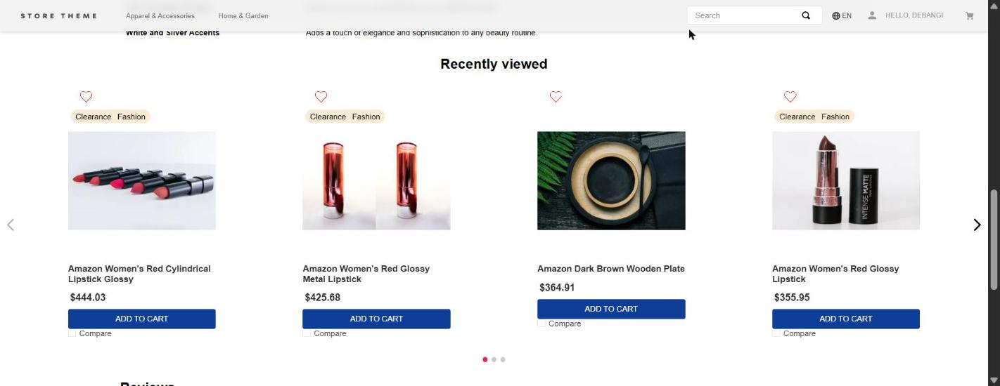
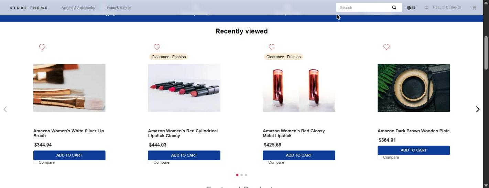

# Recently Viewed Products

A **Recently viewed** shelf for VTEX stores. It remembers the products each shopper viewed, keeps them across visits, and, for logged-in shoppers, can follow them from one device to another. Prices and stock are always fresh, and unavailable products are left out.



| | |
| --- | --- |
| App | `logixalpartnerus.recently-viewed-products` |
| Version | 0.1.1 |
| Live in | Workspace `debangi`, with the B2C theme `logixalpartnerus.store-theme` 1.1.0: https://debangi--logixalpartnerus.myvtex.com/ |
| Type | Two store blocks (a tracker and a shelf) and a Node service for sync |
| Status | Internal Logixal demo app for prospective clients |

## Contents

1. [Why it exists](#why-it-exists)
2. [What it does](#what-it-does)
3. [Demo script](#demo-script)
4. [How it works](#how-it-works)
5. [Setup](#setup)
6. [Privacy](#privacy)
7. [Limitations](#limitations)
8. [Development](#development)

## Why it exists

VTEX has no built-in "recently viewed" shelf. Shoppers who browse, leave and come back, or start on a phone and finish on a laptop, lose track of what they looked at. A shelf of their own recent products brings them straight back.

## What it does

| Shopper | Where the history is kept | On another device |
| --- | --- | --- |
| Not logged in | This browser only | No |
| Logged in, sync off | This browser only | No |
| Logged in, sync on | This browser and the store's Master Data | Yes, after logging in |

- The history holds product IDs and view times only. Prices and stock come from the catalog each time the shelf shows.
- The shelf lists the newest first, leaves out the product being viewed and products out of stock, and hides itself when there's nothing to show.
- With sync on, logging out clears the history from the browser, so the next person on a shared computer never sees it. It comes back at the next login. A logged-out history joins the account at login.



## Demo script

About 5 minutes, on https://debangi--logixalpartnerus.myvtex.com/, where sync is on. Use a test shopper account, and a second browser or private window for step 4.

1. **The problem.** VTEX has no recently viewed shelf; shoppers lose track of what they looked at.
2. **Build a history.** Open two or three product pages, for example `/beauty_sku_56/p`. On the third, scroll to **Recently viewed**: the earlier products, newest first, without the one on screen.
3. **It lasts.** Open the home page: the shelf is there too. Close the tab, open the store again: the history is still there.
4. **Across devices.** Log in as the test shopper, view a product, then log in with the same shopper in the second browser: the same products appear.
5. **Shared computers.** Log out: the shelf disappears. Log back in: it returns.

Key messages: brings shoppers back to products they already showed interest in, works without an account, follows logged-in shoppers across devices, and never shows one person's history to the next.

## How it works

- **Tracker** (`recently-viewed-tracker`, on the product page): records each view in the browser's `localStorage`.
- **Shelf** (`recently-viewed-shelf`): reads the history and fetches the products in groups of 10 through `productsByIdentifier`, keeping the history's order.
- **Sync** (when on): views are sent to the app's GraphQL 3 seconds after a burst of browsing, and the server's history is read when a page loads, at most every 5 minutes. The server identifies the shopper from their own token, validated by VTEX ID; no request names a shopper.
- **Storage:** one Master Data v2 document per shopper (entity `recentlyViewed`), through `@vtex/clients`. Shopper data is never cached.

## Setup

1. Install the app: `vtex install logixalpartnerus.recently-viewed-products@0.x`.
2. Add it to the theme's `manifest.json` (`logixalpartnerus.store-theme` 1.1.0 lists it under `dependencies`).
3. Add `recently-viewed-tracker` to `store.product`, and `recently-viewed-shelf` to any page.
4. Optional, in **Apps → Installed Apps → Recently Viewed Products → Settings**:

| Setting | Default | Limits |
| --- | --- | --- |
| Sync history across devices | Off | |
| Products kept per shopper | 30 | 1 to 50 |
| Days to keep each view | 90 | 1 to 365 |

Shelf props: `title` (default "Recently viewed"), `maxItems` (10), `excludeCurrentProduct` (true) and `hideUnavailable` (true). CSS handles: `recentlyViewedContainer` and `recentlyViewedTitle`.

## Privacy

Sync stores browsing history against a shopper account, so review it with the client's privacy team before turning it on. For this store, sync stays off in production.

- `clearRecentlyViewed` deletes the logged-in shopper's history.
- `purgeInactiveRecentlyViewed` (admin only) deletes up to 100 documents of inactive shoppers per call. Nothing schedules it, so it needs to be run regularly.

## Limitations

- Without sync, the history lives in one browser and is lost if the shopper clears it.
- A shopper who stays logged in doesn't resend views kept only in the browser; they join the server history at the next login.
- Master Data documents are shared across workspaces, so test with test shoppers only.

## Development

```bash
yarn install && (cd node && yarn) && (cd react && yarn)
yarn lint && yarn test:coverage
vtex use debangi && vtex link
```

- Testing record and manual test steps: [docs/TESTING.md](docs/TESTING.md)
- Version history: [CHANGELOG.md](CHANGELOG.md)
- App store description: [docs/README.md](docs/README.md)
