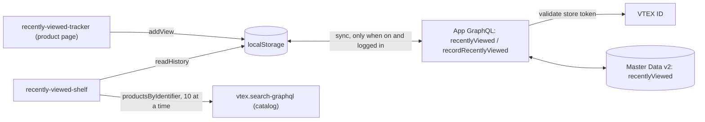

# Recently Viewed Products: technical reference

How the app is built, what it stores and why. For what shoppers and admins see, read [USER-GUIDE.md](USER-GUIDE.md).

| | |
| --- | --- |
| App | `logixalpartnerus.recently-viewed-products` 0.1.1 |
| Builders | `react` 3.x, `store` 0.x, `node` 7.x, `graphql` 2.x, `masterdata` 1.x, `messages` 1.x, `docs` 0.x |
| Stored data | Master Data v2 entity `recentlyViewed`, one document per shopper, only with sync on |
| Origin | Started from VTEX's `cross-device-cart` (`UNLICENSED`); the git history was replaced with a fresh one |

## Contents

1. [Architecture](#architecture)
2. [Store blocks](#store-blocks)
3. [Browser storage](#browser-storage)
4. [Sync](#sync)
5. [GraphQL API](#graphql-api)
6. [Master Data](#master-data)
7. [Security and privacy](#security-and-privacy)
8. [Policies and clients](#policies-and-clients)
9. [Code layout](#code-layout)
10. [Extending it](#extending-it)
11. [Things to know](#things-to-know)

## Architecture



- The browser always holds the history (`localStorage`); the shelf reads only from there.
- With sync on, a logged-in shopper's history is also kept on the server and merged both ways.
- Products are looked up in the catalog every time; the history never holds prices or stock.

## Store blocks

`store/interfaces.json` and `store/blocks.json`:

| Block | Component | Notes |
| --- | --- | --- |
| `recently-viewed-tracker` | `RecentlyViewedTracker` | Reads `productId` from `vtex.product-context` and records one view per product change. Returns `null` |
| `recently-viewed-shelf` | `RecentlyViewedShelf` | Requires `list-context.product-list-static`; its content schema (`contentSchemas.json`) makes the props editable in the Site Editor |

The shelf renders `ExtensionPoint id="list-context.product-list-static"` with the products. The default card layout in `blocks.json`:

```
recently-viewed-shelf
  └ list-context.product-list-static#recently-viewed
      blocks: product-summary.shelf#recently-viewed (image 1:1, name, selling price)
      children: slider-layout#recently-viewed (5 / 3 / 1 per page, not infinite)
```

A theme can override the card by setting its own `list-context.product-list-static` in the `blocks` of `recently-viewed-shelf`.

Shelf props: `title`, `maxItems` (10), `excludeCurrentProduct` (true), `hideUnavailable` (true). Availability means any seller's `commertialOffer.AvailableQuantity` > 0 (`utils/products.ts`).

## Browser storage

Key: `recently-viewed-products:v1:{account}`. Value:

```json
{ "owner": "<shopper id or null>", "items": [{ "productId": "2208", "viewedAt": "<ISO date>" }], "syncedAt": 1795593036831 }
```

- `owner` is set only when sync is on and a shopper is logged in. History with an owner is shown only once the session confirms that same shopper, so the next person on a device never sees it, even while the session loads.
- `addView` merges the new view and trims to `maxItems` and `retentionDays` (`mergeHistory`: newest view per product, newest first).
- A custom window event and the `storage` event keep every open tab in step.
- Storage is read only after mount, so server-rendered and hydrated markup match. If the browser blocks storage, the shelf stays empty and nothing breaks.

## Sync

`react/utils/sync.ts`, used by `hooks/useRecentlyViewed.ts`. Runs only when the session is known, the shopper is logged in and the setting `enableSync` is on.

1. **On session change,** `reconcileOwner` applies the shared-device rules: history owned by someone else is cleared; a logged-in shopper with sync on takes over an anonymous history (with `syncedAt` reset, so it's all sent). Logout clears owned history even if settings failed to load.
2. **Then a sync runs:**
   - Views with `viewedAt >= syncedAt` are pending. If any, they're sent with `recordRecentlyViewed`, which returns the merged server history.
   - If none are pending and the last sync was less than 5 minutes ago, nothing happens. Otherwise `recentlyViewed` pulls the server history.
   - The result is merged into the browser's history, unless the owner changed meanwhile (logout during the request).
3. **Each new view** schedules a sync 3 seconds later; views in that window go together.
4. Only one sync runs at a time. A failure leaves views pending for the next page load.

`>=` rather than `>` (since 0.1.1): a view recorded in the same millisecond a sync started wasn't in that sync, so it must still count as pending. Sending one view twice is harmless, because merging keeps one view per product.

## GraphQL API

`graphql/schema.graphql`. All shopper operations take no user argument; the shopper comes from the token.

| Operation | Auth | Cache | Does |
| --- | --- | --- | --- |
| `recentlyViewed` | `@auth(scope: PUBLIC)` + store token | `PRIVATE`, `ZERO` | The shopper's server history, trimmed to the settings. Refused when sync is off |
| `recentlyViewedSettings` | `PUBLIC` | `PUBLIC`, `SHORT` | `enableSync`, `maxItems`, `retentionDays`; nothing personal |
| `recordRecentlyViewed(items)` | `PUBLIC` + store token | none | Merges up to 100 views into the server history and returns it. Refused when sync is off |
| `clearRecentlyViewed` | `PUBLIC` + store token | none | Deletes the shopper's document, even with sync off |
| `purgeInactiveRecentlyViewed` | `PRIVATE`, product 66, `workspace-read-write` | none | Deletes up to 100 documents whose `lastActivityAt` is before the retention cutoff; returns the count |

Errors: `AuthenticationError` for a missing or invalid token, `ForbiddenError` when sync is off, `UserInputError` for more than 100 items.

Incoming views are cleaned by `sanitizeItems`: product IDs must match `^[\w-]{1,64}$`, malformed dates are dropped, and future dates are moved to now so they can't stay on top.

## Master Data

`masterdata/recentlyViewed/schema.json` (builder `masterdata` 1.x):

| Field | Type | Notes |
| --- | --- | --- |
| `id` | the shopper's VTEX ID user ID | Document ID, so one document per shopper |
| `items` | array of `{ productId, viewedAt }`, at most 50 | Newest first |
| `lastActivityAt` | date-time | Indexed; used by the purge |

`v-cache: false`: shopper documents are never cached. Access goes through `@vtex/clients`' `masterDataFor('recentlyViewed')`, with the app token. The shopper is validated first, so the app token is only ever used for that shopper's own document.

The entity name has no workspace in it, so documents are shared across workspaces of the account. Each link or install creates a schema version, with a limit of 60 per entity; delete old ones from time to time.

## Security and privacy

- **The server decides who the shopper is.** `getShopperId` (`node/utils/shopper.ts`) validates `storeUserAuthToken` with VTEX ID (`/api/vtexid/credential/validate`) and requires `authStatus: Success`, the same account and the `webstore` audience. Nothing from the browser selects whose history is read or written.
- **Outages aren't logouts.** A rejected token (400, 401, 403, 404) means logged out; any other VTEX ID failure is passed on as an error.
- **Why the app token for Master Data.** The shopper's own token can't reach the app's entity unless its fields were made public, which would expose every history. The app token is used only after the shopper is validated, and only on that shopper's document.
- **Logs carry no personal data:** the operation and HTTP status only.
- **Only the settings are cached** (in memory, `LRUCache` of 100 entries); shopper data never is.
- **Shared devices:** see the owner rules under Browser storage.

## Policies and clients

| Policy | For |
| --- | --- |
| `ADMIN_DS` | Master Data v2 |
| `outbound-access` `api.vtex.com/api/dataentities/*` | Master Data v2 host used by `@vtex/clients` |
| `outbound-access` `portal.vtexcommercestable.com.br/api/vtexid/credential/validate` | Token validation |
| `colossus-write-logs` | Logging |

Clients (`node/clients`): `VtexId` (a `JanusClient`; `@vtex/api`'s own VTEX ID client only covers sign-in) and `history` (`masterDataFor`). Defaults: 2 retries, 3-second timeout; app settings cached in memory.

## Code layout

```
react/
  RecentlyViewedTracker.tsx   records views
  RecentlyViewedShelf.tsx     shows the history through list-context
  hooks/
    useRecentlyViewed.ts      session, settings, owner rules, sync
    useProductsByIds.ts       catalog lookups, 10 IDs per query, history order kept
  utils/
    storage.ts                localStorage, owner rules, tab events
    sync.ts                   push/pull, debounce, one sync at a time
    history.ts                merge and trim (same rules as the server)
    products.ts               availability, chunking, ordering
node/
  resolvers/index.ts          the five operations
  utils/                      shopper, settings, history merge and sanitizing
  clients/                    VtexId, Master Data
graphql/schema.graphql
masterdata/recentlyViewed/schema.json
store/                        interfaces, default blocks, content schema
```

## Extending it

- **A "clear my history" button** in My Account, calling `clearRecentlyViewed` and clearing `localStorage`.
- **Scheduled purge.** Run `purgeInactiveRecentlyViewed` from a scheduler or another app's cron, repeatedly until it returns 0.
- **Recommendations.** The history is a ready input for "customers who viewed this also viewed".
- **More than 50 products** needs a schema change (`maxItems`), which creates a new schema version.

## Things to know

- Production sync stays off until a privacy review approves it.
- A shopper who stays logged in doesn't resend views kept only in the browser before the server copy was lost; they join at the next login.
- After a link or install, requests can fail with 403 or "GraphQL validation failed" for a minute or so while policies take effect.
- Tests: `yarn test` runs 74 tests (server, shelf, tracker, hooks, sync); `yarn test:coverage` fails under 80% of lines (70% of branches). See [TESTING.md](TESTING.md).
