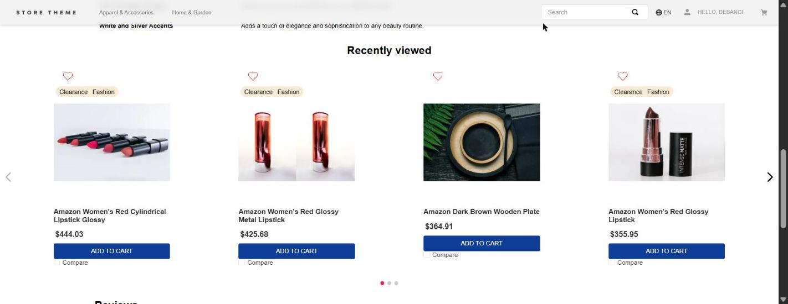
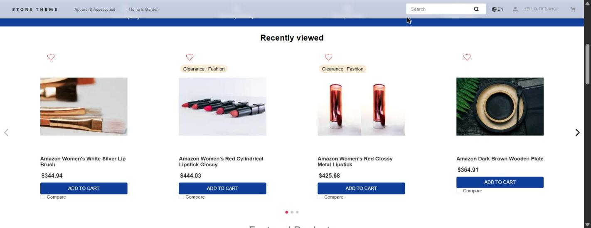
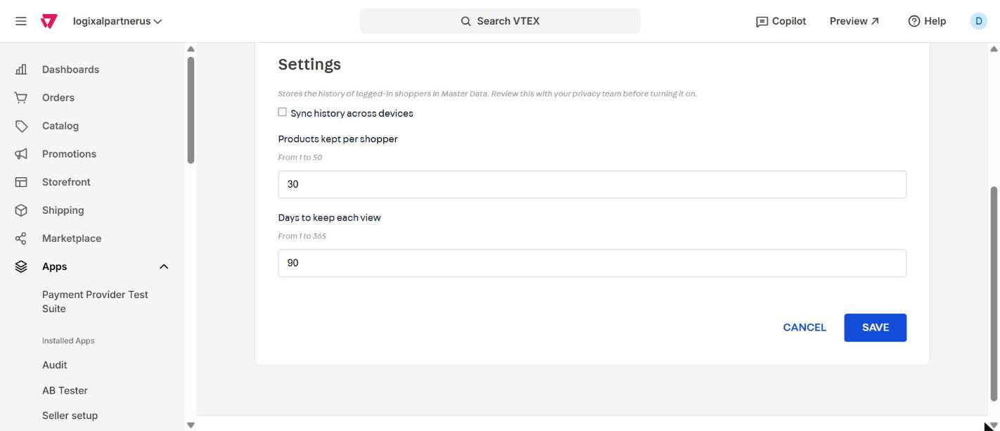

# Recently Viewed Products: user guide

What shoppers see, what store admins can set, and how the history behaves in each case. For how it's built, see [TECHNICAL.md](TECHNICAL.md); for test steps, [TESTING.md](TESTING.md).

Examples use the `debangi` workspace, which runs the B2C theme `logixalpartnerus.store-theme` 1.1.0 with both blocks placed.

## Contents

1. [What shoppers see](#what-shoppers-see)
2. [How the history behaves](#how-the-history-behaves)
3. [Settings](#settings)
4. [Placing the blocks](#placing-the-blocks)
5. [Privacy tools](#privacy-tools)
6. [Common questions](#common-questions)

## What shoppers see

A **Recently viewed** shelf, wherever the theme places it. In this store, on product pages and the home page.

- **Newest first.** The product viewed last comes first; viewing a product again moves it back to the front.
- **Not the product on screen.** On a product page, that product is left out.
- **Only what can be bought.** Products out of stock are left out. Prices, images and stock are read from the catalog every time, never from the history.
- **Hidden when empty.** A shopper with no history sees nothing at all, not an empty shelf.
- **Normal product cards.** Each card has the theme's image, name, price and Add to cart, in a slider: 5 per row on desktop, 3 on tablet, 1 on phone.

Nothing is shown to say that views are being recorded; the tracker block is invisible.

## How the history behaves

| Shopper | Where the history lives | Lasts | On other devices |
| --- | --- | --- | --- |
| Not logged in | This browser | Until the browser's site data is cleared | No |
| Logged in, sync off | This browser | Until the browser's site data is cleared | No |
| Logged in, sync on | This browser and the store's Master Data | Until it expires (see Settings) | Yes, after logging in there |

With sync on:

- **Views are sent in bursts.** A few seconds (3) after the shopper stops browsing, the new views go to the server together.
- **Other devices' views come in** when a page loads, at most every 5 minutes, and at login.
- **Logging in keeps what was browsed before.** Views from before login join the account's history.
- **Logging out clears this browser.** The next person on a shared computer never sees the previous shopper's history. It comes back from the server at the next login.
- **Another shopper logging in** on the same browser starts from their own history, never the previous one's.

The history keeps product IDs and view times only.

## Settings

**Apps → Installed Apps → Recently Viewed Products → Settings** in the Admin (for `debangi`: `/admin/apps/logixalpartnerus.recently-viewed-products/setup`).

| Setting | Default | Allowed | What it does |
| --- | --- | --- | --- |
| Sync history across devices | Off | | Keeps logged-in shoppers' history in Master Data as well |
| Products kept per shopper | 30 | 1 to 50 | How many products the history holds; the oldest drop off |
| Days to keep each view | 90 | 1 to 365 | Views older than this disappear from the shelf and the server |

- Keep more products than the shelf shows, so it stays full after unavailable products are left out.
- Values outside the allowed range fall back to the default (or the maximum, for values that are too large).
- Settings are read per request and cached in memory briefly, so a change can take a short while to show.
- Sync stays **off in production** for this store until a privacy review approves it. In the `debangi` workspace it is **on**, for demos and testing.

## Placing the blocks

Both blocks come from this app and are placed in the theme:

| Block | Where | What it does |
| --- | --- | --- |
| `recently-viewed-tracker` | `store.product` | Records each product view. Renders nothing |
| `recently-viewed-shelf` | Any page, usually the product page and the home page | Shows the history |

Shelf options, set in the theme's blocks or in the Site Editor:

| Option | Default | Effect |
| --- | --- | --- |
| `title` | "Recently viewed" | The shelf's heading |
| `maxItems` | 10 | Products shown at most |
| `excludeCurrentProduct` | true | Leaves out the product on screen |
| `hideUnavailable` | true | Leaves out products out of stock |

## Privacy tools

- **A shopper can clear their history.** The `clearRecentlyViewed` mutation deletes the logged-in shopper's server history, even with sync off. There's no button for it in the theme yet; a store would add one to My Account.
- **Old histories can be purged.** `purgeInactiveRecentlyViewed` (Admin only) deletes up to 100 histories with no activity within the retention period, per call. Nothing runs it automatically, so with sync on it needs to be run regularly.

Review sync with the client's privacy team before turning it on: it stores browsing history against shopper accounts.

## Common questions

**Why doesn't a product I viewed appear?** It's the product on screen, it's out of stock, it's older than the retention period, or the history is full and it dropped off.

**Why is the shelf missing?** There's nothing to show yet. View a couple of products first.

**Why doesn't my phone show what I viewed on my laptop?** Sync is off, or you aren't logged in on both. With sync on, the history arrives after logging in, or within 5 minutes on a page load.

**Does it slow pages down?** The tracker only writes to the browser. The shelf asks the catalog for products in groups of 10, after the page loads.
